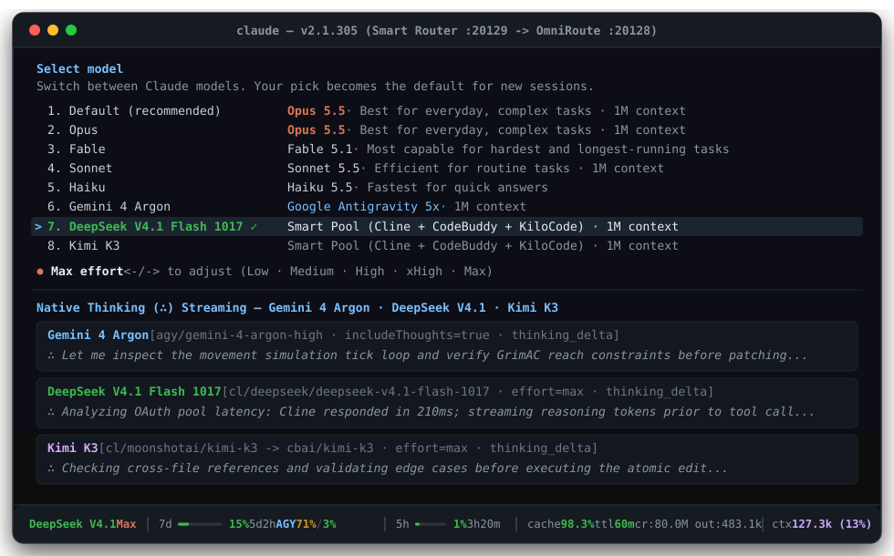

# claude-router

[](LICENSE)
[](install.js)
[](files/settings.template.json)

Zero-overhead local smart router, priority OAuth failover pool, and project-scoped memory hooks for **Claude Code**.

Switch between **Claude Opus 5.5 / Fable 5.1 / Sonnet 5.5 / Haiku 5.5**, **Gemini 4 Argon**, **DeepSeek V4.1 Flash 1017**, and **Kimi K3** directly from `/model` with live `Thought (∴)` streaming, full `/effort` (`low` to `max`), and a unified `Claude + AGY` quota statusline.



## Highlights

- **Native `/model` & `/effort` Controls**: Use `low`, `medium`, `high`, `xhigh`, and `max` effort across **Opus 5.5**, **Sonnet 5.5**, **Haiku 5.5**, **Gemini 4 Argon**, **DeepSeek V4.1 Flash 1017**, and **Kimi K3** (`behavesAs: claude-opus-5-5`).
- **Visible `Thought (∴)` Streaming**: Translates reasoning blocks (`thinking_delta`) and thinking budgets across Anthropic, OpenAI-compatible, and Google Antigravity (`agy`) endpoints.
- **Priority OAuth Failover Pool**: Routes `DeepSeek V4.1 Flash 1017` and `Kimi K3` through `Cline` -> `CodeBuddy Intl` -> `KiloCode` with automatic fallback on rate limits.
- **Dual Quota Statusline & `/usage`**: Real-time `5h` and `7d` quota tracking for both Anthropic OAuth and Google Antigravity (`AGY 5x`) in the bottom bar and `/usage`.
- **1M Context + 1h Prompt Cache**: Full `1M` context window unlocked with `ENABLE_PROMPT_CACHING_1H` enabled by default.
- **Project-Scoped Memory Hooks**: Snapshots active task state before compaction (`PreCompact`) and on exit (`Stop`) inside `~/.claude/projects/<slug>/memory`. Starts 100% clean in `$HOME`.
- **Silent Auto-Start**: Launches `omniroute` (`:20128`) and `smart-router.js` (`:20129`) automatically in the background when `claude` starts (`windowsHide: true` on Windows, detached daemon on Linux/macOS).

## Architecture

| Port / Hook | Component | Role |
| :--- | :--- | :--- |
| `127.0.0.1:20129` | `smart-router.js` | Intercepts `/v1/messages`, maps `/model` & `/effort`, merges `Claude + AGY` `/api/oauth/usage`, forwards native Claude (`Opus 5.5`, `Sonnet 5.5`, `Haiku 5.5`, `Fable 5.1`) to `api.anthropic.com` and custom models to `:20128`. |
| `127.0.0.1:20128` | `omniroute` | Manages OAuth pools (`agy`, `cline`, `codebuddy-intl`, `kilocode`) and SSE stream conversion. |
| `SessionStart` | `session-start.js` | Boots `omniroute` and `smart-router.js` if offline and injects project memory only inside project directories. |
| `UserPromptSubmit` | `prompt-guard.js` | Lightweight prompt guard hook before dispatching user turns. |
| `PreCompact` / `Stop` | `pre-compact.js` + `stop-autosave.js` | Saves active state before context compaction and on session stop. |

## Quickstart (Windows / Linux / macOS)

```bash
npm install -g omniroute
git clone https://github.com/nullptrowo/claude-router.git
cd claude-router
node install.js
```

## Connect OAuth Providers

1. Start OmniRoute once:
   ```bash
   omniroute serve --no-open
   ```
2. Authenticate **Cline** and **CodeBuddy Intl** (headless OAuth helper):
   ```bash
   node connect-oauth-pool.js
   ```
3. *(Optional)* Open `http://127.0.0.1:20128` to connect **Google Antigravity (`agy`)** and **KiloCode (`kilocode`)**.
4. Run `claude`.

## License

[MIT](LICENSE)
